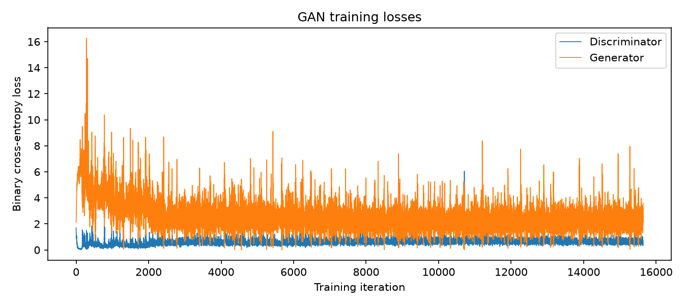
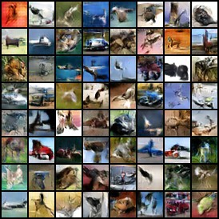

# CIFAR-10 Image Generation with a DCGAN-Style Model

An project for training an unconditional generative adversarial network to produce 32 × 32 color images. The project examines both training behavior and the gap between generated and real images. The reported samples show varied colors and rough object-like forms, with remaining blur and distorted structure. Results here come from the supplied report and were not regenerated during portfolio preparation.

## Data and approach

The model trains on all 50,000 CIFAR-10 training images across ten balanced classes. The 10,000-image test set stays separate. Pixels are scaled to [-1, 1], with no augmentation. Labels are used for dataset checks and balanced evaluation sampling; they do not condition image generation.

The PyTorch generator maps 100-dimensional Gaussian noise through transposed convolutions, BatchNorm, and ReLU, ending with Tanh. The discriminator uses convolutions and LeakyReLU and produces a raw logit. Both networks use Adam with learning rate 0.0002 and betas (0.5, 0.999), alternating updates with BCEWithLogitsLoss for 20 epochs at batch size 64. NumPy supports evaluation sampling, Matplotlib plots losses, and torchvision exports images.

Evaluation compares 2,000 fresh generated images with 2,000 balanced held-out real images using 2,048-dimensional Inception features from torch-fidelity. A second disjoint real subset provides context. KID uses 100 subsets of 1,000 images and is reported in raw units.

## Key findings

- Generated-versus-real **FID was 65.4814**, compared with **25.3196** for the real-control comparison.
- Generated-versus-real **KID was 0.0304778**, with subset SD **0.0009721**. Real-control KID was **−0.0000885**, with subset SD **0.0000776**.
- Mean generator loss decreased from **4.9807 to 2.3404**, while mean discriminator loss increased from **0.3898 to 0.7090**, between epochs 1 and 20.
- The final unfiltered grid contains **64 samples**; blur and malformed shapes remain, and coverage of all ten classes was not established.

## Results in context

*Report page 2: both losses fluctuate as the networks compete; loss values alone do not establish image quality.*

*Report page 3: the original 274 × 274 embedded grid is retained without enlargement or enhancement. It shows the remaining visual limitations.*

## Limitations

Only one training seed and the final checkpoint were evaluated. FID depends on sample size and protocol; the real-control value is context, not a score to subtract. KID subset SD is not a confidence interval. Aggregate metrics do not establish class coverage or rule out memorization. The report's duplicate-check claim is not implemented in the supplied script.

